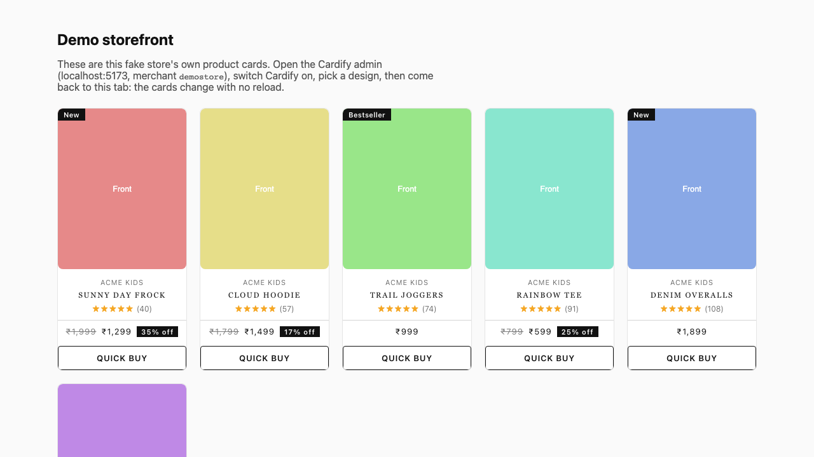

# Cardify Lite

Restyle a storefront's product cards **from the outside**. A merchant flips one switch in an admin screen, and the store's own cards are replaced live by one of five designs: no reload, no edits to the widgets that render the cards.

This is a lightweight, self-contained version of an app I built and run in production. It has no store-specific code, and it runs locally with no database.



Write-up: [Cardify: restyling a storefront's product cards without touching its code](https://aniq-haider.vercel.app/blog/cardify)

## How it works

```
cardify-lite/
├── shared/    types, the 5 designs, option schema (zod)
├── backend/   Fastify settings API; serves the SDK (in-memory, MySQL optional)
├── sdk/       Lit 3 web component + overlay engine + 0.5 KB loader
├── admin/     React + Vite: on/off switch, style options, live previews
└── demo/      a static fake storefront to try it on
```

1. **The host store** marks each card cell with `data-cardify-card` and `data-cardify-product='{json}'`; its native link and quick-buy button carry `data-cardify-link` / `data-cardify-quickbuy`. It includes one script tag: `cardify-loader.js?store=<merchantId>` (0.5 KB gzipped).
2. **The loader** reads `GET /cardify/sdk/config/:merchantId`. If Cardify is off, it does nothing. If it is on, it lazily imports the widget bundle (about 10 KB gzipped).
3. **The overlay** hides each native card (never removes it) and mounts `<cardify-card>` in the same cell, so the host's grid or carousel layout is untouched. A `MutationObserver` covers cards that appear later.
4. **Behaviour is delegated back to the host.** Clicking a Cardify card clicks the hidden native link, and quick buy clicks the hidden native button, so the store's own routing, popups and analytics still run.
5. **It fails safe.** Backend down, config error or blocked bundle: the native cards stay exactly as they were.
6. **No polling.** Config refreshes on page load and when the tab regains focus.

## Run it

Needs Node 22+, pnpm and Python 3 (for the static demo server).

```bash
./start.sh
```

- Demo storefront: <http://localhost:4200>
- Admin: <http://localhost:5173>, merchant `demostore`, admin key from `backend/.env` (`ADMIN_API_KEY`, `change-me-please` by default)
- Backend: <http://localhost:4100>

Open the admin, switch **Use Cardify cards on my storefront** on, pick a design, then return to the demo tab: the cards change without a reload.

Other commands: `pnpm test` · `pnpm typecheck` · `pnpm build:sdk`.

To persist settings, set `DATABASE_URL` (MySQL) in `backend/.env`; the table is created on boot.

## API

| Route | Auth | |
|---|---|---|
| `GET /cardify/sdk/config/:merchantId` | public, CORS `*` | what the loader reads |
| `GET /cardify/sdk/cardify-{loader,widget}.js` | public, CORS `*` | the built SDK |
| `GET/PUT /cardify/admin/:merchantId/settings` | `x-admin-key` | admin reads and saves |

The server refuses to start without `ADMIN_API_KEY`, so an unset key can never mean "open".

## Designs

`classic` · `minimal` · `overlay` · `hover-reveal` · `editorial`: chosen per merchant, with accent, text and background colour, corner radius, image shape (1:1, 4:5, 3:4) and toggles for badge, quick buy, rating and compare-at price. All settings are validated with one shared zod schema.

All five share one DOM structure and differ only in CSS, which is why click and quick-buy bridging works for every design. To add one, add an entry to `DESIGNS` in `shared/src/index.ts` and a `:host([design="<id>"])` block in `sdk/src/card.ts`, then `pnpm build:sdk`.

## Integrating a store

Render the data attributes described above on your card cells and include the loader script. The host contract is documented at the top of `sdk/src/overlay.ts`.

## Not included

- Production hosting and deploy configuration.
- Per-merchant admin auth (this version uses one shared admin key).
- The browser regression suite from the production app, which is tied to a specific storefront.

## License

MIT
